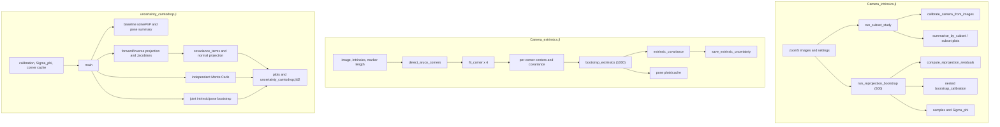

# Cam-to-droplet uncertainty overview

## 1. Summary

This analysis propagates camera-calibration and ArUco-pose uncertainty into a
virtual pendant-drop contour in the model-local meridian plane. It combines
finite-difference-free Jacobians of the inverse projection with Monte Carlo
checks and a joint intrinsic/pose bootstrap. The contour is generated by
`Model.PD_fn`, not extracted from an observed droplet boundary.
An optional observed-contour mode accepts a student-provided JLD2 edge file;
its file contract and run instructions are in
[`README_edge_uncertainty.md`](./README_edge_uncertainty.md).

For the recorded `zoom5` run (seed 123, 1000 baseline pose draws, 500 linear
Monte Carlo draws, 2000 joint draws, and `σ_pix = 0.3 px`), the median
linearized/independent-Monte-Carlo normal uncertainty is 0.02850/0.02843 mm.
The joint/independent median pointwise normal-σ ratio is 0.213; apex-radius
standard deviations are 0.02574 mm (joint) and 0.09968 mm (independent).
After the helper move, the regenerated analysis output matches the pre-move
backup exactly across all 50 JLD2 keys and values.

## 2. Theory and models

### Projection and frames

For a model-local point \(X_m=(r,z,s)^T\), the transform order used by
`Model.ForwardModel` and `Camera.project_model_to_image` is
(`src/forwardmodel.jl:13`, `src/camera.jl:947`):

\[
R_{\mathrm{tot}} = R R_{\mathrm{rel}}, \qquad
t_{\mathrm{tot}} = R t_{\mathrm{rel}} + t,\qquad
X_c = R_{\mathrm{tot}}X_m+t_{\mathrm{tot}}.
\]

The point is normalized by camera depth, distorted, and mapped to pixels:
\[
x=X_{c,1}/X_{c,3},\quad y=X_{c,2}/X_{c,3},\quad
u=f_x x_d+c_x,\quad v=f_y y_d+c_y.
\]
The OpenCV coefficient order is
\([k_1,k_2,p_1,p_2,k_3]\). With \(q=x^2+y^2\) and
\(L=1+k_1q+k_2q^2+k_3q^3\),
\[
x_d=xL+2p_1xy+p_2(q+2x^2),\qquad
y_d=yL+p_1(q+2y^2)+2p_2xy.
\]
The equations are implemented in `src/camera.jl:235`.

The inverse projection (`src/camera.jl:977`,
`src/camera_uncertainties.jl:1003`) undistorts the normalized pixel ray,
transforms it into marker/model coordinates, intersects it with the plane
whose third model coordinate is `plane_coordinate`, then returns model-local
\((r,z)\). The analysis sets `plane_coordinate = 0 mm` and forward-projects
the physical contour with its third coordinate fixed to zero. The exported
contour is therefore in the model-local meridian frame, in millimeters, not
the camera or image frame.

### Intrinsic calibration and covariance

The intrinsic vector order is
\[
\phi=[f_x,f_y,c_x,c_y,k_1,k_2,p_1,p_2,k_3].
\]
`Camera_intrinsics.jl` runs `run_reprojection_bootstrap` with 500 draws
(`ProjectScripts/Camera_intrinsics.jl:70`,
`src/camera_uncertainties.jl:374`). It obtains pooled two-dimensional
reprojection residuals and their full \(2\times2\) covariance
\(\Sigma_{\mathrm{corner}}\), perturbs calibration corners, recalibrates,
and computes \(\Sigma_\phi=\operatorname{cov}(\phi^{(b)})\)
(`src/camera_uncertainties.jl:161`, `src/camera_uncertainties.jl:202`,
`src/camera_uncertainties.jl:374`).

Two different routines named `bootstrap_calibration` exist:

* `Camera.bootstrap_calibration` in `src/camera.jl:691` takes `sigma_x` and
  `sigma_y` and draws independent x/y corner noise; this is a diagonal
  per-corner noise model.
* `Camera.IntrinsicUncertainty.bootstrap_calibration` in
  `src/camera_uncertainties.jl:202` takes a full \(2\times2\)
  `Sigma_corner` and draws correlated bivariate corner noise.

The \(\Sigma_\phi\) used by this analysis comes from the **nested**
`Camera.IntrinsicUncertainty` routine through `run_reprojection_bootstrap`,
not from `Camera.bootstrap_calibration`. Their noise models and outputs are
not interchangeable; they were not merged.

### ArUco corners and pose bootstrap

The extrinsics script detects one ArUco marker, fits intensity profiles at
each corner, and stores each fitted correction and covariance
(`ProjectScripts/Camera_extrinsics.jl:64`,
`src/camera_uncertainties.jl:1819`, `src/camera_uncertainties.jl:514`). The fitted corner covariance is a
separate \(2\times2\) matrix per corner, in \(\mathrm{px}^2\).
`bootstrap_extrinsics` independently perturbs each of the four fitted corners
using its own covariance, then calls OpenCV `solvePnP`
(`src/camera_uncertainties.jl:765`). `extrinsic_covariance` summarizes its
poses (`src/camera_uncertainties.jl:861`).

For cam-to-drop, the corner centers and these four covariances are loaded from
`aruco_corner_results_zoom5_camtodrop.jld2` by
`src/camera_uncertainties.jl:668`. A 1000-draw fixed-intrinsics
bootstrap supplies the baseline pose mean and full \(6\times6\) covariance.
The separately stored `extrinsic_uncertainty_zoom5.jld2` is read only for a
legacy standard-deviation comparison; it is **not** the pose covariance used
in the analysis. It is no longer consistent with the corner-fit noise model
used here.

### Undistortion derivative and linear propagation

Let \(d(x,y,\phi_d)\) be the OpenCV distortion map. At an undistorted point
where \(d(x,y,\phi_d)=(x_d,y_d)\), the implicit function theorem gives
\[
\frac{\partial(x,y)}{\partial\phi_d}
=-\left(\frac{\partial d}{\partial(x,y)}\right)^{-1}
  \frac{\partial d}{\partial\phi_d}.
\]
The implementation is `src/camera_uncertainties.jl:1236`; the complete
inverse-projection Jacobian is computed at
`src/camera_uncertainties.jl:1173`. Its columns correspond
to nine intrinsic parameters, six extrinsic parameters, the relative-pose
normal offset, and the interleaved pixels.

For output contour vector \(y=[r_1,z_1,\ldots,r_N,z_N]^T\), first-order
propagation is
\[
\Sigma_y \simeq J_\phi\Sigma_\phi J_\phi^T+
J_e\Sigma_eJ_e^T+\sigma_{\mathrm{pix}}^2J_pJ_p^T+
\sigma_{\mathrm{offset}}^2J_oJ_o^T.
\]
The independent version uses independent intrinsic and pose covariance
terms; `covariance_terms` assembles block-diagonal and full-pose versions
(`src/camera_uncertainties.jl:1411`). The pixel term uses independent
isotropic pixel noise. With `σ_pose_offset = 0`, the offset term is zero.

For point \(i\), the unit normal is \(n_i\). Normal covariance is
\(\Sigma_n[i,j]=n_i^T\Sigma_y[2i-1:2i,2j-1:2j]n_j\); pointwise normal
standard deviations are \(\sqrt{\operatorname{diag}(\Sigma_n)}\)
(`src/camera_uncertainties.jl:1340`, `src/camera_uncertainties.jl:1356`).

### Independent Monte Carlo, joint bootstrap, and modes

The independent Monte Carlo samples the 9 intrinsics from \(\Sigma_\phi\)
and the 6D extrinsic vector independently from their combined covariance,
then inverse-projects the fixed virtual pixels. The joint bootstrap first
draws an intrinsic vector from \(\Sigma_\phi\), then reruns `solvePnP` for
that vector using independently perturbed fitted corners and the same
per-corner covariance basis (`src/camera_uncertainties.jl:1280`). Thus the
pose solve responds to each intrinsic draw; this captures the
intrinsic-dependent pose response. It does **not** model shared raw
calibration images and ArUco corners as one common observation set. The
analysis metadata records the independent-intrinsics assumption and common
ArUco corner-noise basis.

Covariance eigenvectors are characterized by projections onto three rigid
contour motions (two translations and in-plane rotation), a scale direction,
and the remaining shape component (`src/camera_uncertainties.jl:1670`).
These labels describe the contour-space eigenvectors; they do not prove that
the physical likelihood can distinguish the modes.

## 3. Code structure

### Files and entry behavior

| File | Lines | Purpose |
|---|---:|---|
| `ProjectScripts/Camera_intrinsics.jl` | 380 | Top-level zoom5 calibration subset study, correlated-corner intrinsic bootstrap, convergence summaries, and plots. No named functions or entry guard. |
| `ProjectScripts/Camera_extrinsics.jl` | 309 | Top-level ArUco detection/corner fitting, extrinsic bootstrap, pose summaries, plots, and save. No named functions or entry guard. |
| `ProjectScripts/uncertainty_camtodrop.jl` | 662 | Defaults to `CONTOUR_SOURCE = :virtual`; `main()` starts at line 102 and the parse-safe entry guard is at line 660. |
| `src/camera_uncertainties.jl` | 2902 | Include-only implementation for camera calibration/uncertainty helpers, observed-edge input validation, and cam-to-drop projection math; included in `Camera.IntrinsicUncertainty`. |

`Camera_intrinsics.jl` and `Camera_extrinsics.jl` remain top-level scripts as
requested. No project test includes any of these scripts. In particular,
`test/uncertainty_camtodrop.jl` includes `src/forwardmodel.jl`, not the
analysis script, so tests do not launch the full analysis.

### Function inventory

Categories: **core math** computes uncertainty, projection, or statistics;
**plumbing** performs I/O, calibration orchestration, fitting, or plotting;
**test helper** exists primarily to verify a numerical derivative.
The first two scripts define no named functions; their work is top-level.

#### `ProjectScripts/uncertainty_camtodrop.jl`

| Function (line) | Purpose; main inputs → outputs | Category |
|---|---|---|
| `sample_covariance_from_pose_cache` (67) | **Commented out/deprecated**; former cache search for pose covariance. | plumbing |
| `main` (102) | Orchestrate projection, covariance, Monte Carlo, plots, and result save; configuration/data files → JLD2 and figures. | plumbing |

#### `src/camera_uncertainties.jl`

| Function (line) | Purpose; main inputs → outputs | Category |
|---|---|---|
| `_coerce_camera_matrix` (40) | Normalize camera-matrix representations; input → \(3\times3\) `Float64` matrix. | plumbing |
| `_coerce_distortion_coeffs` (62) | Normalize distortion representations; input → coefficient vector. | plumbing |
| `require_keys` (73) | Validate required JLD2 fields; dictionary and keys → nothing or error. | plumbing |
| `resample_curve` (79) | Resample a scalar curve at uniformly spaced indices; values/count → vector. | plumbing |
| `detect_aruco_corners` (1819) | Detect marker corners in an image; path/K/distortion → corners and IDs. | plumbing |
| `aruco_uncertainty_setup` (478) | **Commented out/deprecated**; former ArUco intensity/interpolation setup. | plumbing |
| `sigmoid` (496) | Evaluate an edge-intensity logistic model; positions/parameters → intensities. | plumbing |
| `fit_corner` (514) | Fit two image edges and propagate their intercept scatter; image interpolant/corner/edge settings → correction, \(2\times2\) covariance, diagnostics. | core math |
| `load_or_fit_aruco_corners` (668) | Load cached corners/covariances or fit and save them; camera data → fitted \(4\times2\) centers and four covariances. | plumbing |
| `plot_aruco_corner_corrections` (1859) | Plot fitted corner corrections and confidence ellipses; fit results → plot. | plumbing |
| `plot_aruco_corner_diagnostic` (1940) | Plot intensity and fitted profiles for one corner; image/corner/fit → plot. | plumbing |
| `plot_aruco_edge_profile_residuals` (2075) | Plot edge-profile residuals; image/fit → plot. | plumbing |
| `bootstrap_extrinsics` (765) | Perturb four corners with per-corner covariance and solvePnP; centers/K/distortion → rotation and translation samples. | core math |
| `extrinsic_covariance` (861) | Summarize pose samples; rotations/translations → marginal covariances and means/diagnostics. | core math |
| `list_camera_images` (2184) | List matching image files; directory/extensions → sorted paths. | plumbing |
| `random_image_subset` (2211) | Select a seeded image subset; directory/count/seed → paths. | plumbing |
| `calibrate_camera_from_images` (2242) | Run OpenCV checkerboard calibration; images/settings → calibration result dictionary. | plumbing |
| `compute_reprojection_residuals` (161) | Project calibration corners and estimate residual covariance; calibration points/poses → residuals, σx/σy, \(\Sigma_{\rm corner}\). | core math |
| `bootstrap_calibration` (202) | Refit intrinsic parameters under full 2D corner covariance; calibration data/\(\Sigma_{\rm corner}\) → samples, mean, covariance. | core math |
| `run_subset_study` (256) | Cache calibrations across random image subsets; directories/settings → subset results and reference intrinsics. | plumbing |
| `run_reprojection_bootstrap` (374) | Load/cache intrinsic bootstrap and covariance; calibration directories/draw count → samples and \(\Sigma_\phi\). | core math |
| `plot_reprojection_residuals` (2364) | Plot pooled reprojection residuals; residual array → plot/file. | plumbing |
| `summarise_by_subset` (440) | Summarize subset calibration samples; results/sizes → summary dictionary. | core math |
| `plot_subset_influence` (2389) | Plot subset-size effects; summary/reference calibration → plots. | plumbing |
| `plot_subset_seed_values` (2456) | Plot calibration estimates by seed; samples/reference → plots. | plumbing |
| `plot_extrinsic_distributions` (2549) | Plot pose-sample distributions; rotations/translations → plot/files. | plumbing |
| `plot_extrinsic_bootstrap_stability` (2628) | Plot pose uncertainty against draw count; samples/checkpoints → plot. | plumbing |
| `plot_extrinsic_convergence_mean` (2720) | Plot pose-mean convergence across seeds; samples/checkpoints → plot. | plumbing |
| `save_extrinsic_uncertainty` (2841) | Validate and save pose means/covariances; result/path → success flag and JLD2. | plumbing |
| `_camtodrop_primal` (987) | Extract primal real value from a `ForwardDiff.Dual` or real; scalar → `Float64`. | core math |
| `_right_perturbed_rotation` (921) | Apply a right Rodrigues increment; mean rotation/delta → rotation matrix. | core math |
| `inverse_project_camtodrop` (1003) | Undistort pixels and intersect rays with the model plane; pixels/parameters/poses → \(r,z\). | core math |
| `forward_project_camtodrop` (1116) | Project model-local contour points through the same frame chain; \(r,z\)/parameters/poses → pixels and depth. | core math |
| `camtodrop_jacobians` (1173) | Differentiate inverse projection with respect to parameters and pixels; reference contour/poses → Jacobian bundle. | core math |
| `undistortion_implicit_parameter_jacobian` (1236) | Evaluate the implicit distortion-coefficient derivative; normalized pixel/distortion → \(2\times5\) Jacobian. | test helper |
| `sample_gaussian` (1261) | Draw from a positive-semidefinite multivariate normal; mean/covariance/RNG → sample. | core math |
| `joint_intrinsic_extrinsic_bootstrap` (1280) | Pair intrinsic samples with corner-noise solvePnP draws; corners/covariances/intrinsic draws → pose samples. | core math |
| `apex_radius_measure` (1478) | Fit the near-apex \(z(r)\) quadratic and return radius; contour → mm. | core math |
| `stack_rz` (93) | Interleave \(r,z\) values; two vectors → \(2N\) vector. | core math |
| `unstack_rz` (103) | Split interleaved \(r,z\); vector → two vectors. | core math |
| `contour_normals` (1340) | Estimate normalized contour normals; \(r,z\) → \(N\times2\) matrix. | core math |
| `normal_covariance` (1356) | Project point covariance onto normals; covariance/normals → \(N\times N\) covariance. | core math |
| `normal_sigmas` (1407) | Extract normal-direction standard deviations; covariance/normals → σ vector. | core math |
| `relative_position_assessment` (1621) | Use the offset Jacobian and joint-camera normal σ to calculate the 1 mm offset response, break-even offset, and relative scale/surface-tension errors from ArUco depth. | core math |
| `block_diagonal_extrinsic` (108) | Assemble rotation and translation marginal covariance blocks; two \(3\times3\) matrices → \(6\times6\). | core math |
| `rotation_log` (942) | Map a rotation matrix to its rotation-vector logarithm; rotation → radian vector. | core math |
| `summarize_pose_samples` (952) | Estimate mean pose and full six-parameter covariance using right increments; pose samples → mean and covariance. | core math |
| `correlation_matrix` (115) | Normalize a covariance by marginal standard deviations; covariance → correlation matrix. | core math |
| `_validate_correlation_matrix` (121) | Check shape, symmetry, unit diagonal, finiteness, and positive semidefiniteness. | plumbing |
| `covariance_terms` (1411) | Assemble camera, pixel, offset, and total linearized covariance terms; Jacobians/covariances/noise levels → named matrices. | core math |
| `edge_normal_pixel_covariance` (1371) | Build the interleaved pixel covariance from normal-only edge σ and point correlations. | core math |
| `sample_inverse_contour` (1432) | Inverse-project a sampled camera/pose state at required `plane_coordinate`; pixels/parameters/poses → interleaved \(r,z\). | core math |
| `validate_observed_contour_order` (1452) | Check that observed points follow one meridian side from apex to needle. | plumbing |
| `print_leading_modes` (1670) | Decompose covariance modes into rigid, scale, and shape contributions; covariance/contour → eigenpairs and diagnostics. | core math |
| `load_edge_uncertainty_data` (1709) | Load and validate required fields, correlation, image path, and 1-based image bounds. | plumbing |
| `make_normal_band` (2884) | Build a plotting polygon from contour, normals, and σ; → plot shape. | plumbing |

Local named helpers are also present: `make_ellipse` (1909) creates plotting
ellipses; `to_pixels` (2111) maps edge coordinates for diagnostic plots;
`_fail` (2270) constructs a calibration-failure result; `_panel` (2431) and
`_seed_panel` (2501) build plot panels; `get_result_value` (2861) reads a
named value from accepted result containers. These remain local to their
enclosing functions.

### Data flow

### Configuration and saved JLD2 data

| Script | Relevant current values |
|---|---|
| `Camera_intrinsics.jl` | `zoom="zoom5"`, subset study `[5]` with one seed, intrinsic bootstrap \(N_{\rm boot}=500\), convergence sizes `[5,10,20,35,50]`, convergence seed 1. |
| `Camera_extrinsics.jl` | zoom5, marker length 10 mm, \(N_{\rm boot}=1000\), seed 123, 6 edge profiles/corner, edge-profile start 8 px, 10 convergence seeds. |
| `uncertainty_camtodrop.jl` | Defaults to `CONTOUR_SOURCE=:virtual`; `:observed` reads `EDGE_DATA_FILE`, validates the edge file, and writes a separate result. Existing zoom5 virtual settings remain 100 points, 500 independent draws, 2000 joint draws, 1000 baseline pose draws, marker length 10 mm, seed 123. |

JLD2 schemas below describe the script outputs/caches. Arrays are Julia
one-based; rotation matrices are marker/camera pose matrices as produced by
OpenCV. Parameter order and units are stated where meaningful.

| Output | Keys, shapes, meaning and units |
|---|---|
| `camint_all.jld2` | `camera_matrix` \(3\times3\) px intrinsics; `dist_coeffs` (5); `rms` scalar px; `objpoints` (49,117,3) and `imgpoints` (49,117,2) for the current 49-image calibration; `rvecs`, `tvecs` (49,3); `image_size` tuple. |
| `subset_N_seedsM.jld2` | `K_samples` vector of \(3\times3\) matrices; `dist_samples` vector of coefficient vectors; `rms_values` px; `seed_ids`. |
| `reprojection_bootstrap_Nboot500.jld2` | `sigma_x`, `sigma_y` px; `Sigma_corner` \(2\times2\) px²; `residuals` \(5733\times2\) px; `samples` \(500\times9\), `mean_φ` (9), `Σ_φ` \(9\times9\), with \(\phi=[f_x,f_y,c_x,c_y,k_1,k_2,p_1,p_2,k_3]\); `N_boot`. |
| `convergence_subset.jld2` | `conv_results` dictionary keyed by subset size (five entries in the current cache); each entry contains `K`, `dist`, and `std_intrinsics` (9). |
| `aruco_corner_results_zoom5.jld2` and `aruco_corner_results_zoom5_camtodrop.jld2` | `opencv_corners_px`, `fitted_corners_px` \(4\times2\) px; `Σ_corners` four \(2\times2\) px² matrices; `corner_results` (4), `marker_ids` (1), and `zoom_level`. The `_camtodrop` variant is loaded by the analysis. |
| `extrinsic_bootstrap_zoom5_fit_corner_N1000.jld2` | `R_samples` (N matrices of \(3\times3\)), `t_samples` (N 3-vectors, mm), `N_boot`, `Σ_corners` (four \(2\times2\) px² matrices), `seed`, `zoom_level`, `corners_px` \(4\times2\) px, `K`, `dist`, and `marker_length_mm`. |
| `extrinsic_uncertainty_zoom5.jld2` | `Σ_rvec` \(3\times3\) rad², `Σ_t` \(3\times3\) mm², `rvec_mean` (3) rad, `t_mean` (3) mm. This legacy file is for comparison only in the cam-to-drop analysis. |
| `uncertainty_camtodrop.jld2` and `uncertainty_camtodrop_before_reorg.jld2` | The latter is the byte-for-byte pre-move backup; the complete result key map follows. |

`metadata` records the intrinsic and extrinsic ordering, units, plane/frame
definition, right-perturbation convention, seed/draw counts, noise basis,
cached corner path, standard-deviation comparison, round-trip error, and
stated independence/virtual-plane assumptions. When
`SIGMA_POSE_OFFSET == 0`, it also stores the computed relative-position
assessment; the optional `ASSUMED_OFFSET_ACCURACY_MM` records the user's
accuracy estimate and enables a verdict against the break-even offset.

The complete `uncertainty_camtodrop.jld2` inventory is:

* `virtual_r`, `virtual_z` (100 each, mm); `virtual_u`, `virtual_v` (100
  each, px); `roundtrip_errors` (100, mm); `fitted_aruco_corners_px`
  (\(4\times2\), px).
* `Σ_intrinsics` (\(9\times9\)); `Σ_rvec` (\(3\times3\), rad²); `Σ_t`
  (\(3\times3\), mm²); `rvec_mean` (3, rad); `t_mean` (3, mm).
* `Σ_ext_block`, `Σ_ext_full`, `Σ_ext_legacy_blockdiag` (\(6\times6\));
  `Σ_corners` (four \(2\times2\) px² matrices); `baseline_R_samples`
  (1000 \(3\times3\) rotations); `baseline_t_samples` (1000 3-vectors, mm).
* `Σ_camera_independent_block`, `Σ_camera_independent_full_ext`, `Σ_pixel`,
  `Σ_pose_offset`, `Σ_total_independent_block`,
  `Σ_total_independent_full_ext`, `Σ_linear_monte_carlo`,
  `Σ_camera_joint_reference`, `Σ_pixel_joint_reference`,
  `Σ_total_joint_reference`, `Σ_joint_monte_carlo`
  (\(200\times200\) mm² each).
* `Σ_normal_camera`, `Σ_normal_pixel`, `Σ_normal_total`, `Σ_normal_joint`
  (\(100\times100\) mm² each); `normal_sigma_independent`,
  `normal_sigma_linearized`, `normal_sigma_monte_carlo`,
  `normal_sigma_joint`, `normal_sigma_joint_camera`,
  `normal_sigma_joint_total`, `normal_sigma_pixel` (100 mm values each);
  `normal_sigma_ratio` (100, dimensionless).
* `baseline_to_stored_extrinsic_sd_ratio` (6, dimensionless);
  `joint_apex_radius_mm` (2000 mm); `independent_apex_radius_mm` (500 mm);
  `metadata` (dictionary with 20 entries, including the relative-position
  assessment and optional assumed offset accuracy).

The covariance inputs use
\(\phi=[f_x,f_y,c_x,c_y,k_1,k_2,p_1,p_2,k_3]\), whose first four
coordinates are pixels and final five are dimensionless, and
\([\delta r_x,\delta r_y,\delta r_z,\delta t_x,\delta t_y,\delta t_z]\),
where rotations are right-perturbation radians and translations are mm.
`Σ_ext_*` therefore has mixed rotation/translation units, while
`Σ_intrinsics` has mixed pixel/distortion units.
Contour covariance rows/columns use interleaved order
\([r_1,z_1,\ldots,r_{100},z_{100}]\), in the model-local meridian frame at
`plane_coordinate = 0 mm`.

## 4. Remaining simplification proposals

No merge or simplification was performed in Phase 2; it was a pure move.
These proposals and their risks remain open:

| Proposal | Estimated savings | Risk |
|---|---:|---|
| Reuse `Camera`'s `_coerce_camera_matrix` and `_coerce_distortion_coeffs` from the nested module instead of keeping equivalent copies. | 35–45 lines. | Low, but verify `nothing`, matrix, and nested-vector inputs. |
| Reuse parent `Camera.list_camera_images` and `random_image_subset` in the nested module. | 45–55 lines. | Low, but verify file-extension filtering and seeded selection. |
| Extract only common low-level geometry/solvePnP code from `bootstrap_extrinsics` and `joint_intrinsic_extrinsic_bootstrap`. | 20–30 lines. | Moderate; preserve RNG streams, intrinsic sampling, and corner-noise basis exactly. |
| Do not merge the calibration/residual routines in `camera.jl` with nested versions. | None proposed. | Nested residuals expose 2D corner covariance and nested calibration returns the data needed by its bootstrap; contracts differ. |
| Do not merge the two `bootstrap_calibration` routines. | None proposed. | High: one uses independent x/y standard deviations, the other a full correlated \(2\times2\) corner covariance. A merge could change \(\Sigma_\phi\). |
| Do not merge `extrinsic_covariance` and `summarize_pose_samples`. | None proposed. | They use different rotation-mean conventions and output contracts; the latter retains full rotation/translation cross-covariance. |
| Do not merge script-level corner-cache orchestration with the top-level corner fitting in `Camera_extrinsics.jl`. | None proposed. | Their cache/path/configuration roles differ. |

`src/camera_uncertainties.jl` still contains functions outside uncertainty
math, a future cleanup item: general conversion helpers
`_coerce_camera_matrix` and `_coerce_distortion_coeffs`; ArUco/image plumbing
`detect_aruco_corners`, `list_camera_images`, `random_image_subset`, and
`calibrate_camera_from_images`; calibration orchestration
`run_subset_study`; and plotting/reporting functions
`plot_aruco_corner_corrections`, `plot_aruco_corner_diagnostic`,
`plot_aruco_edge_profile_residuals`, `plot_reprojection_residuals`,
`summarise_by_subset`, `plot_subset_influence`, `plot_subset_seed_values`,
`plot_extrinsic_distributions`, `plot_extrinsic_bootstrap_stability`, and
`plot_extrinsic_convergence_mean`. `sigmoid`, `make_ellipse`, and `to_pixels`
are local fitting/plot helpers; `save_extrinsic_uncertainty` is persistence
plumbing. `fit_corner` mixes image fitting and uncertainty estimation, so it
is not included as a clear extraction candidate. The unused
`sample_covariance_from_pose_cache` and `aruco_uncertainty_setup` are
commented out with the approved deprecation notice, not deleted.

## 5. Validation

| Check | What it verifies | Result |
|---|---|---|
| `test/uncertainty_camtodrop.jl` | Forward/inverse round trip, Jacobian dimensions/finiteness and finite differences, covariance symmetry/PSD, implicit undistortion derivative, relative-position assessment, shared-corner sensitivity, and observed-edge contract/plumbing. | 58/58 passed. |
| `test/check_edge_uncertainty_file.jl` | Validate a supplied JLD2 file, image bounds, and projected contour ordering. | Example file passed. |
| `test/distortion_undistortion.jl` | Distortion/undistortion round trip. | 4/4 passed. |
| `test/pixel_to_model.jl` | ForwardModel/pixel-to-model round trip. | 4/4 passed. |
| `unittests/pose.jl` | Identity projection and relative rotation. | 4/4 passed. |
| `unittests/sensitivity.jl` | Rotation identity, Euler angles, OpenCV reconstruction, and matrix validity. | 7/7 passed; PlotUtils emitted non-fatal tick warnings. |
| Run the analysis with output redirected to a temporary directory | Executes the reorganized analysis and compares the regenerated JLD2 with the pre-move backup. | Completed; all 50 keys and values match exactly; maximum forward/inverse round-trip error \(5.35\times10^{-15}\) mm. |
| Both camera-uncertainty figure scripts | Reproduce the existing figure files without overwriting the workspace outputs. | Both scripts ran; all 25 expected PDF filenames were generated, and all rasterized pages matched the existing PDFs. |
| Load the `main_BI.jl` preamble | Imports and includes the camera and model modules only; does not execute inference. | `Model` loaded without errors. |
| Compare result with the older `uncertainty_camtodrop_before.jld2` | Historical comparison against the pre-existing snapshot, distinct from the pre-reorganization backup. | All 43 non-metadata result keys match exactly. Existing metadata differs only in Windows path capitalization for `corner_results_file`; two assessment fields were added. |
| `Camera_intrinsics.jl`, `Camera_extrinsics.jl` | Reproduce their saved outputs. | Not rerun; neither script nor functions it calls were changed. |

Historical numeric JLD2 maximum absolute differences against the older
`uncertainty_camtodrop_before.jld2` snapshot (all 43 non-metadata result keys
match exactly):

| Key | Max \(|\Delta|\) | Key | Max \(|\Delta|\) |
|---|---:|---|---:|
| `baseline_R_samples` | 0.0 | `baseline_t_samples` | 0.0 |
| `baseline_to_stored_extrinsic_sd_ratio` | 0.0 | `fitted_aruco_corners_px` | 0.0 |
| `independent_apex_radius_mm` | 0.0 | `joint_apex_radius_mm` | 0.0 |
| `normal_sigma_independent` | 0.0 | `normal_sigma_joint` | 0.0 |
| `normal_sigma_joint_camera` | 0.0 | `normal_sigma_joint_total` | 0.0 |
| `normal_sigma_linearized` | 0.0 | `normal_sigma_monte_carlo` | 0.0 |
| `normal_sigma_pixel` | 0.0 | `normal_sigma_ratio` | 0.0 |
| `roundtrip_errors` | 0.0 | `rvec_mean` | 0.0 |
| `t_mean` | 0.0 | `virtual_r` | 0.0 |
| `virtual_u` | 0.0 | `virtual_v` | 0.0 |
| `virtual_z` | 0.0 | `Σ_camera_independent_block` | 0.0 |
| `Σ_camera_independent_full_ext` | 0.0 | `Σ_camera_joint_reference` | 0.0 |
| `Σ_corners` | 0.0 | `Σ_ext_block` | 0.0 |
| `Σ_ext_full` | 0.0 | `Σ_ext_legacy_blockdiag` | 0.0 |
| `Σ_intrinsics` | 0.0 | `Σ_joint_monte_carlo` | 0.0 |
| `Σ_linear_monte_carlo` | 0.0 | `Σ_normal_camera` | 0.0 |
| `Σ_normal_joint` | 0.0 | `Σ_normal_pixel` | 0.0 |
| `Σ_normal_total` | 0.0 | `Σ_pixel` | 0.0 |
| `Σ_pixel_joint_reference` | 0.0 | `Σ_pose_offset` | 0.0 |
| `Σ_rvec` | 0.0 | `Σ_t` | 0.0 |
| `Σ_total_independent_block` | 0.0 | `Σ_total_independent_full_ext` | 0.0 |
| `Σ_total_joint_reference` | 0.0 |  |  |

Development issues recorded:

* An incorrect y-component residual in the undistortion derivative was
  identified by comparing the implicit Jacobian against centered finite
  differences. The residual now uses the y distortion equation
  (`src/camera_uncertainties.jl:1090`); the five-coefficient derivative
  comparison passes in `test/uncertainty_camtodrop.jl:115`.
* The earlier extrinsic noise basis did not match the corner-specific
  covariance model used for the cam-to-drop analysis. The current baseline
  pose bootstrap and joint bootstrap both use the same fitted corner centers
  and per-corner \(2\times2\) covariance matrices
  (`ProjectScripts/uncertainty_camtodrop.jl:164`,
  `src/camera_uncertainties.jl:1280`). The former stored pose file is retained
  only as a diagnostic comparison. The exact provenance of the earlier
  mismatch is not established by this Phase 2 diff.

## 6. Results

| Quantity | Value | Configuration |
|---|---:|---|
| Median normal σ, linearized | 0.0285001 mm | zoom5, 100 points, full \(6\times6\) pose covariance |
| Median normal σ, independent MC | 0.0284266 mm | 500 draws, \(\Sigma_\phi\) and pose sampled independently |
| Median joint/independent normal-σ ratio | 0.213 | 2000 paired intrinsic/solvePnP draws |
| 10–90% pointwise normal-σ ratio | 0.181–0.265 | same run |
| Independent apex-radius SD | 0.09968 mm | 500 contour draws |
| Joint apex-radius SD | 0.02574 mm | 2000 contour draws |
| Joint/independent apex-radius SD ratio | 0.258 | same run |
| Trace of full camera covariance | 0.161317 mm² | independent linear propagation, full pose covariance |
| Trace of pixel covariance | 0.00112988 mm² | \(\sigma_{\rm pix}=0.3\) px |
| Maximum forward/inverse round-trip error | \(5.35\times10^{-15}\) mm | virtual 100-point contour |
| Relative-position assessment | \(Z=40.3536\) mm; 1 mm offset response \(22.4754\) µm; joint-camera median normal σ \(6.0162\) µm; \(\delta^*=0.267678\) mm; scale error \(2.478\%\)/mm; surface-tension error \(4.956\%\)/mm | `SIGMA_POSE_OFFSET=0`; derived from `J_offset` and joint-camera normal σ, without additional sampling |

The `zoom5` results do not establish values for other zoom settings or for
observed drop contours.

## 7. Assumptions, conventions, and limitations

* Rotations use right perturbations:
  \(R_{\rm sample}=R_{\rm mean}\exp(\delta r)\), with
  \(\delta r=\log(R_{\rm mean}^T R_{\rm sample})\).
* The contour is a `PD_fn` virtual contour, not an observed boundary. Its
  third model coordinate is fixed at zero.
* `σ_pix = 0.3 px` is a placeholder for contour-pixel uncertainty, not a
  measured noise level. The normal-offset uncertainty is currently zero.
* The relative-position assessment runs only at zero pose-offset σ. It uses
  the ArUco optical depth \(|t_{\rm mean}[3]|\); surface-tension error assumes
  surface tension scales with drop-size squared. The offset error is systematic
  for a given mount and does not average out over repeated measurements.
* Results use the zoom5 intrinsics and one marker/image corner-fit cache only.
  Extrapolation to other zoom settings is not verified.
* The independent model treats intrinsic and extrinsic covariance as
  independent. The joint bootstrap conditions each solvePnP on its sampled
  intrinsics but does not resample the intrinsic-calibration images and
  ArUco marker observations jointly.
* `extrinsic_uncertainty_zoom5.jld2` is not consistent with the current
  corner-fit covariance basis and is only used to print an SD ratio.
* In `main_BI.jl:65`, `main_BI.jl:68`, and `main_BI.jl:73`, the active test pose is fixed at
  \((\theta_x,\theta_y,\theta_z)=(0,0,0)\) degrees and
  \(t_{\rm rel}=(-8.3,0.6,0)\) mm; the camera/marker pose \(R,t\) is obtained
  from ArUco pose estimation and then held fixed. `prior6` defines Normal
  priors with angle SD 5 degrees and translations centered at
  \((-8.25,0.6,0)\) mm with SD 0.5 mm
  (`src/priors.jl:29`, `src/priors.jl:32`), but the AISM sampling statement at
  `main_BI.jl:133` is commented out. Thus relative pose is configured
  for inference but not inferred by the active script. If those pose
  parameters are inferred, their freedom may absorb some rigid-body modes in
  camera covariance; the present code does not quantify that posterior
  coupling. The prior angles are degrees as documented by
  `src/camera.jl:1053`.

## 8. Status

* **Done:** approved helper moves; module-qualified calls; required
  `plane_coordinate` keyword; explicit script values; `Printf` import;
  commented deprecated helpers; tests; same-seed analysis and numeric output
  comparison; this overview.
* **Not done by instruction:** rerunning `Camera_intrinsics.jl` or
  `Camera_extrinsics.jl`. No merges were made.
* **Not committed:** no staging or commit was performed.

## 9. Open decisions and next steps

### Relative pose in the likelihood

`main_BI.jl` sets a nominal relative pose and defines `prior6`, but currently
holds the pose fixed because the AISM sampling block is commented out. Before
using camera covariance in a fit, decide whether the relative object pose is
fixed or inferred. If inferred, avoid counting the same rigid-body freedom
both as camera uncertainty and as unconstrained object-pose variation; include
the pose priors and cross-covariance consistently.

### Candidate likelihood integration

For flattened contour residuals, use a covariance of the form
\[
\Sigma_y=J_c\Sigma_cJ_c^T+\sigma_{\rm pix}^2J_pJ_p^T,
\]
where \(J_c\) covers intrinsic/extrinsic parameters and retains
cross-point correlations. The camera part is low rank relative to a
\(2N\times2N\) contour covariance; the Woodbury identity can reduce solve and
log-determinant cost when the pixel term is nonsingular. Alternatively,
project to normal distances with a block normal projection before evaluating
the likelihood. A likelihood in \((r,z)\) retains both coordinates; a
normal-distance likelihood discards tangential residuals and needs a
carefully defined residual/normal convention. The current JLD2 stores the
full covariance needed to evaluate either approach.

### Decisions needing user input

1. What measured value/model should replace the placeholder
   `σ_pix = 0.3 px`?
2. Should relative object pose be fixed, or inferred under `prior6` (and
   should camera-pose uncertainty be marginalized jointly with it)?
3. Should the first likelihood use full \((r,z)\) residuals or only normal
   distances?
4. Which observed contours and zoom settings should be included?

### Work that can proceed after those decisions

* Inspect and document the active likelihood path in `main_BI.jl`, including
  whether its sampling block is enabled in the intended run.
* Add a covariance-aware residual likelihood using the stored full covariance
  and compare dense versus low-rank/Woodbury evaluation.
* Add tests for covariance symmetry/positive semidefiniteness and likelihood
  equivalence, then validate against observed contours and additional zoom
  settings when data and measured pixel noise are selected.
